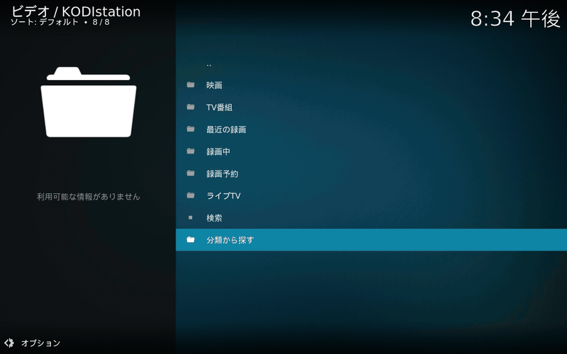

# KODIstation

[English](README.md) | 日本語



フル動画 (1:57): [kodistation-demo.mp4](https://cdn.jsdelivr.net/gh/MyFeetHurt/kodistation@main/media/kodistation-demo.mp4) · スクリーンショット: [録画一覧](media/screenshot-recordings.png) · [詳細](media/screenshot-details.png) · [番組表](media/screenshot-guide.png) · [ライブTV](media/screenshot-live.png)

KODIstation は [EPGStation](https://github.com/l3tnun/EPGStation) 2.x 用の Kodi ビデオアドオン
（`plugin.video.epgstation`）です。EPGStation の録画を、サーバーが持つ番組情報をすべて付けて一覧・再生でき、
ライブTV の視聴、番組表、録画予約の管理もできます。

## 機能

- **録画**: 最近の録画、録画中、放送局別、ジャンル別、ルール別、検索。実際のファイル長、途中までの録画の表示、
  再生するファイル（TS / エンコード済み）の選択、再生中の番組情報。
- **映画・TV番組**: 番組情報から録画を番組とエピソードにまとめて新しい順に表示。ジャンルからも探せます。
  ジャンル名は日本語・英語を選択可能。
- **ライブTV**: 地デジ・BS・CS を、放送中と次の番組付きで視聴。
- **番組表**: 放送局・日付ごと、ジャンル絞り込みと放送中マーク付き。番組表から録画（エンコード設定を選択）。
- **録画予約**: 予約一覧、重複・競合、スキップ。予約の削除、スキップ / スキップ解除、録画中の停止。
- **録画の管理**: 保護 / 保護を解除 / 削除（録画全体、またはその中の一つのファイル）。
- **アートワーク**: 録画のサムネイルをポスター・ファンアートに。ない場合は Kodi のアイコン。
- 日本語・英語の画面表示。

> [!WARNING]
> **KODIstation は設定した EPGStation サーバーに書き込みます。** Kodi から録画予約の作成・削除、放送回の
> スキップ、録画中の停止、録画の保護と **録画（ファイル）の削除** ができます。削除は確認を求めますが、
> 元に戻せません。そうしてよいサーバーにだけ接続してください。

## インストール

Kodi は KODIstation Repository から KODIstation をインストールし、以後はリリースごとに自動で更新します
（Kodi がリポジトリを確認するのは 1 日 1 回程度です）。

1. *設定 → システム → アドオン*: *提供元不明のアドオン* をオンにします。
2. *設定 → ファイルマネージャー → ソースを追加*: `https://myfeethurt.github.io/kodistation/`、名前は例えば
   `KODIstation`。
3. *アドオン → zip ファイルからインストール → KODIstation → repository.kodistation-x.y.z.zip*。
4. *アドオン → リポジトリからインストール → KODIstation Repository → ビデオアドオン → KODIstation →
   インストール*。

すでに zip ファイルから KODIstation を入れている場合: リポジトリ（手順 4）で KODIstation を開き、一度
*インストール*（または *更新*）を押します。「手動インストール」のコピーを置き換えるか聞かれたら *はい*、
「関連データを削除しますか？」には **いいえ**（設定が残ります）。以後はリポジトリから自動で更新されます。

## 動作環境と設定

- Kodi 20 (Nexus) 以降、全プラットフォーム。
- EPGStation 2.x（2.10.0 で確認）。Kodi の端末から HTTP で接続できること。

設定（*アドオン → マイアドオン → ビデオアドオン → KODIstation → 設定*）:

- **サーバー**: EPGStation の URL（例 `http://epgstation.local:8888`）。必要なら Basic 認証のユーザー名と
  パスワード（EPGStation の前段のリバースプロキシが求める場合）。
- **表示**: 1 ページの件数、ジャンル名の言語（日本語 / 英語）、一覧に実際のファイル長、既定で再生するファイル。
- **ライブTV**: ライブ配信モード（無変換、またはサーバーの変換モード）、地上波のサブチャンネルを表示（オフ: 各局のメインチャンネルのみ）。
- **録画**: 番組表から録画するときの録画後エンコード。

## 非公式

KODIstation は個人の独立したプロジェクトです。EPGStation およびその作者（l3tnun）、Kodi / Team Kodi /
XBMC Foundation とは関係がなく、承認も受けていません。Kodi® は XBMC Foundation の登録商標です。

## 開発

```
uv sync --frozen
make ci          # lint、テスト（無料放送の録画から取ったフィクスチャを偽の EPGStation が配信）、kodi-addon-checker、公開監査
make fake        # フィクスチャを偽の EPGStation として :8889 で配信
make zip         # アドオンとリポジトリアドオンの再現可能な zip を dist/ に作成
```

端末ごとの設定（Kodi の端末、EPGStation）はリポジトリ外のファイルに置きます。
[local.env.example](local.env.example) を参照してください。テスト用データは無料放送のチャンネルのみです。

## ライセンス

MIT（[LICENSE](LICENSE)）。変更履歴: [changelog.txt](plugin.video.epgstation/changelog.txt)。
